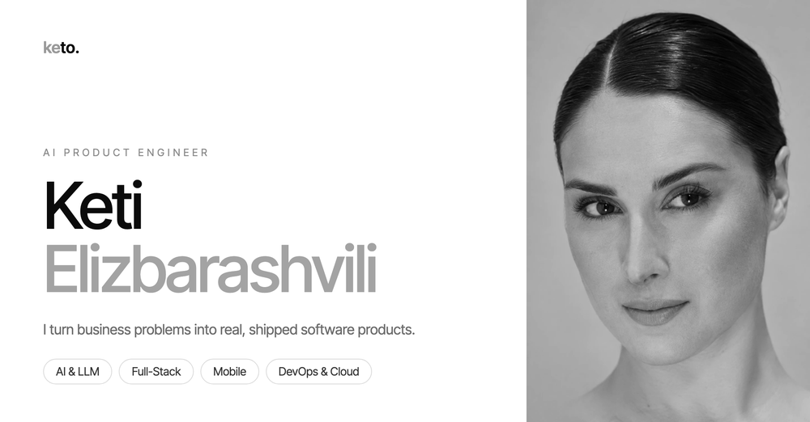

 

### AI Product Engineer

I turn business problems into real, shipped software products.

[**ketielizbarashvili.com**](https://www.ketielizbarashvili.com) &nbsp;·&nbsp; [LinkedIn](https://www.linkedin.com/in/keti-e-90669b216/) &nbsp;·&nbsp; [Medium](https://medium.com/@elizbarashviliketi44) &nbsp;·&nbsp; [Email](mailto:ketielizbarashvilidev@gmail.com)

---

### About

I take a business problem, shape it into a product, and ship it to production, combining **AI**, **full-stack engineering** and **DevOps** to deliver software that real users depend on.

### What I do

| Service | Focus |
|---|---|
| **AI Development & Integration** | LLM integrations, AI assistants, intelligent agents, RAG systems |
| **AI Automation** | Business workflows, AI customer support, document processing |
| **Full-Stack Web** | SaaS platforms, dashboards, admin panels, APIs: React, Next.js, Node.js |
| **Mobile Apps** | Cross-platform and iOS apps, MVPs, App Store deployment |
| **DevOps & Cloud** | CI/CD, Docker, Kubernetes, AWS, infrastructure as code |
| **E-Commerce** | Custom Shopify stores, storefronts, integrations |

### Selected work

- **KitKat × Formula 1**: solo full-stack & DevOps for a multi-country raffle platform (Georgia, Armenia, Azerbaijan), delivered in 25 days
- **MEAMA**: led front-end development of the e-commerce storefront
- **Instinct.ai**: privacy-first AI platform that helps people detect fake job offers and recruitment scams
- **Corqueboard**: digital signage platform with a full admin panel
- **Adidas · LEGO · Nike · Pandora · Caterpillar**: DevOps for enterprise finance platforms

→ [See all projects & iOS apps](https://www.ketielizbarashvili.com/products)

### Stack

         

---

<picture>
  <source media="(prefers-color-scheme: dark)" srcset="https://raw.githubusercontent.com/KetiElizbarashvili/KetiElizbarashvili/output/github-snake-dark.svg" />
  
</picture>

Open to new roles & product work — <a href="mailto:ketielizbarashvilidev@gmail.com">let's talk</a>

